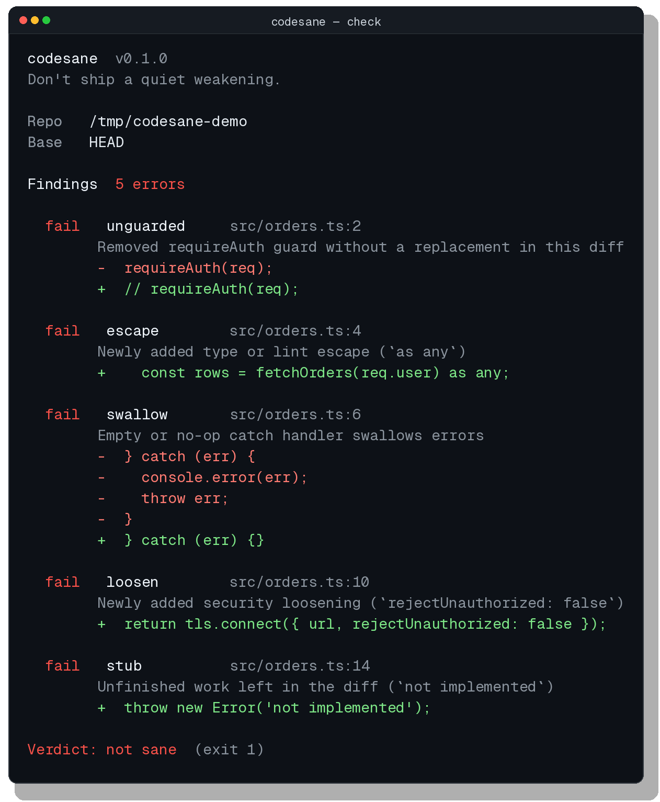

# codesane

**Don't ship a quiet weakening.**

[MIT](./LICENSE) · `npx codesane` · CLI, git hook, MCP, GitHub Action

Coding agents don't just rewrite tests. They also empty a catch block, add `as any`, comment out an auth check, or leave `throw new Error('not implemented')` so the feature appears to work. A markdown rule will not stop this, because the same model reads it. codesane re-reads the diff and exits 1 with file and line for each finding.

It is the sibling of [shipsane](https://github.com/MaxWang007/shipsane), which covers the test side. codesane looks at production code.



## Install

```bash
# one shot, no install
npx codesane

# or install the hook in this repo
npx codesane hook install --pre-commit

# or point a parent agent at the MCP server
npx codesane mcp
```

Add a stdio MCP server with `{ "command": "npx", "args": ["-y", "codesane", "mcp"] }` (see [examples/mcp.claude.json](examples/mcp.claude.json)) and tell the agent, or a parent reviewer, to call `codesane_check` before declaring done.

## GitHub Action

Copy [examples/github-action.yml](examples/github-action.yml) to `.github/workflows/codesane.yml`:

```yaml
- uses: actions/checkout@v4
  with:
    fetch-depth: 0
- uses: MaxWang007/codesane@v0
  with:
    base: ${{ github.event.pull_request.base.sha || github.event.before }}
```

`@v0` is the latest 0.x source tag of this repo. Findings show up as workflow annotations (file and line) and in the job summary, not only in the raw log. The action ignores an all-zero `base` — that is what GitHub sends as `github.event.before` on the first push of a branch — and falls back to codesane's auto-detected default branch.

## Quickstart

Run it at the end of an agent session, in CI, or from a hook. codesane looks at the current git worktree (unstaged and staged) against `--base`, which defaults to the upstream default branch if one exists, otherwise `HEAD`. Test files are skipped.

```bash
npx codesane
npx codesane check --base origin/main
npx codesane check --json                 # or --markdown, for CI / PR comments
```

Exit codes: `0` sane, `1` findings, `2` tool error.

## What it catches

- Empty or no-op error handlers: `catch {}`, `except: pass`, `rescue nil`, or a catch that only logs and returns `null` / `[]` / `{}` / `0` / `false` without rethrowing. Also a handler that previously rethrew after that line was removed.
- Newly added type or lint escapes: `as any`, `as unknown as`, `@ts-ignore`, `@ts-nocheck`, `@ts-expect-error`, `eslint-disable`, `# noqa`, `# type: ignore`, `// nolint`, `@SuppressWarnings`
- Auth, permission, or validation guards that disappeared and did not reappear elsewhere in the same diff (`requireAuth`, `isAuthenticated`, `verifyToken`, `sanitize`, and similar)
- Security loosenings: `rejectUnauthorized: false`, `verify=False`, `NODE_TLS_REJECT_UNAUTHORIZED`, `InsecureSkipVerify`, `curl -k`, CORS origin `*`, `dangerouslySetInnerHTML`, `.innerHTML =`, `eval(`, `new Function(`, `shell=True`, `chmod 777`
- Unfinished work on added lines: `not implemented`, `NotImplementedError`, `todo!()`, `throw new Error('TODO')`, `// TODO: implement`, or a newly added exported function whose body is only a stub

A catch that still rethrows is left alone. A guard that moved to another file is left alone. A pre-existing `as any` or TODO on an unchanged line is left alone. Bare `exec(` is not flagged.

Silent catch-and-return is already treated as an agent failure mode: [aws-samples/sample-autonomous-cloud-coding-agents#257](https://github.com/aws-samples/sample-autonomous-cloud-coding-agents/issues/257) asks for a gate that flags `catch { return [] }` / `return null` / `return {}`, because a swallowed failure plus a fabricated happy path produces a green run that proves nothing.

Here is the real output from the checked-in demo fixture in [`examples/demo`](examples/demo), after an agent "fixed" an orders helper: it commented out `requireAuth`, added `as any`, emptied the catch, turned off TLS verification, and left `refundOrder` throwing `not implemented`.

```text
codesane  v0.1.0
Don't ship a quiet weakening.

Repo   /tmp/codesane-demo
Base   HEAD

Findings  5 errors

  fail   unguarded     src/orders.ts:2
        Removed requireAuth guard without a replacement in this diff
        -  requireAuth(req);
        +  // requireAuth(req);

  fail   escape        src/orders.ts:4
        Newly added type or lint escape (`as any`)
        +    const rows = fetchOrders(req.user) as any;

  fail   swallow       src/orders.ts:6
        Empty or no-op catch handler swallows errors
        -  } catch (err) {
        -    console.error(err);
        -    throw err;
        -  }
        +  } catch (err) {}

  fail   loosen        src/orders.ts:10
        Newly added security loosening (`rejectUnauthorized: false`)
        +  return tls.connect({ url, rejectUnauthorized: false });

  fail   stub          src/orders.ts:14
        Unfinished work left in the diff (`not implemented`)
        +  throw new Error('not implemented');

Verdict: not sane  (exit 1)
```

The command was:

```bash
npx codesane check /tmp/codesane-demo --base HEAD
```

## What it does not do

codesane is not a substitute for code review. It cannot see a weakening that was committed and then reverted before the hook ran. It does not use a model to judge whether a change is "weaker" in some subtle semantic sense — only deterministic diffs, so the same input always produces the same report. It does not re-run tests.

The pre-commit hook diffs uncommitted changes against `HEAD`. The pre-push hook diffs the commits being pushed against the remote tip (or, on a new branch, the auto-detected default branch). A hook installed from an earlier snapshot always used `--base HEAD`, which misses already-committed weakenings at push time; run `npx codesane hook install --pre-push` again to replace a codesane hook.

## Config

Project file: `.codesane.yml`. A user-level `~/.codesane.yml` is used as a fallback and is overlaid by the project file. `--config` loads a single file and ignores the defaults.

```yaml
base: origin/main
ignore:
  - vendor/**
  - generated/**
disabled:
  - stub
# or, equivalently:
# rules:
#   stub: false
allow:
  - path: src/legacy.ts
    rule: escape
    reason: "Legacy payload type, tracked in issue 12"
```

An allow rule needs a `reason`. Allowed hunks still appear in the report; they just do not fail the run. `--fail-on-warning` treats warnings (including allowlisted findings) as failures.

A finding can also be suppressed in the source with `codesane-ignore` or `codesane-ignore: swallow` on the same line or the previous line.

`codesane explain <rule>` prints a one-pager for any detector id: `swallow`, `escape`, `unguarded`, `loosen`, `stub`.

## License

MIT © 2026 [MaxWang007](https://github.com/MaxWang007)
